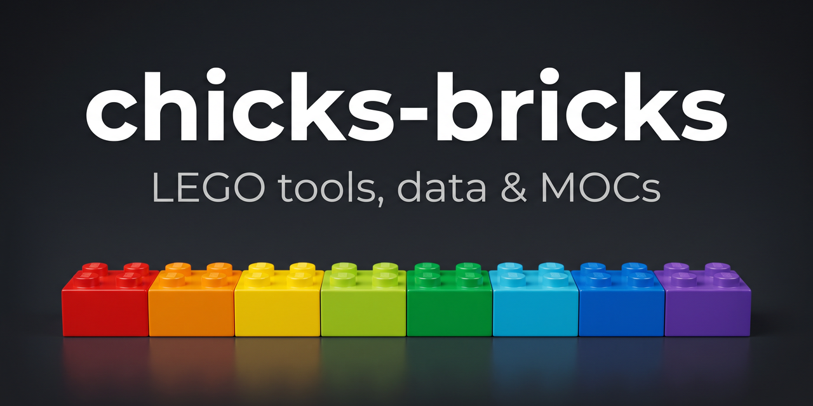

# chicks-bricks

[](https://scorecard.dev/viewer/?uri=github.com/fini-net/chicks-bricks)
[](https://github.com/fini-net/chicks-bricks/issues)
[](https://github.com/fini-net/chicks-bricks/pulls)
[](https://github.com/fini-net/chicks-bricks?tab=GPL-2.0-1-ov-file)


[](docs/social-preview-prompt.md)

## Tools

### part-colors

`bin/part-colors` answers the recoloring question: given a set of parts,
which colors is it available in? Give it a CSV of parts or a Rebrickable
set number and it reports:

- **Monochrome** - colors in which every part in the list is available
- **Near misses** - colors that almost work, with the parts that block them
- **Bottlenecks** - the parts with the fewest available colors, which
    constrain your palette the most

```shell
# MOC-61370 Business Card Holder, from the bundled example parts list
bin/part-colors --parts-file examples/business_card_holder.parts.csv \
    --title 'MOC-61370 Business Card Holder'

# any official set, straight from the Rebrickable API
bin/part-colors --set 850425-1
```

Output for the [Business Card Holder](https://rebrickable.com/mocs/MOC-61370/chicks/business-card-holder/):

```text
MOC-61370 Business Card Holder
11 distinct parts, 33 pieces

Monochrome: available for all 11 parts
  Black, Blue, Dark Bluish Gray, Green, Light Bluish Gray, Red, White, Yellow

Near misses (>= 50% coverage)
  Dark Blue             10/11 parts
                        missing: 3684
  Dark Turquoise        10/11 parts
                        missing: 3894
  Lime                  10/11 parts
                        missing: 3894
  ...

Bottlenecks (fewest available colors first)
  3894   x1   Technic Brick 1 x 6 with Holes  12 colors
  3895   x1   Technic Brick 1 x 12 with Holes  14 colors
  3684   x12  Slope Brick 75 2 x 2 x 3        19 colors
  ...
```

Requires a free [Rebrickable API key](https://rebrickable.com/users/) in
`REBRICKABLE_API_KEY` (sourcing a local `.env` works too). Prefer the
environment variable over `--api-key` - command-line arguments are visible
in process listings. Responses are cached under `data/cache/`, so repeat
runs are instant and quota-free.
Rebrickable removed MOC inventories from API v3 in April 2020, so MOC parts
lists go through `--parts-file` (see [issue #2][issue-2]). There is much more in
`bin/part-colors --man`: JSON/CSV output, transparent-color filtering, a
rarity filter, and an offline mode.

[issue-2]: https://github.com/fini-net/chicks-bricks/issues/2

### brick-labels

`bin/brick-labels` answers the sorting question: which of Tom Alphin's
[LEGO Brick Labels](https://brickarchitect.com/labels/) cover the parts
you actually have? It spans both generations of the collection: the
current [LEGO Parts Guide](https://brickarchitect.com/parts/), where
every part has a printable label, and the frozen v40 bulk download
(December 2023) that many AFOLs already have on their drawers.

```shell
# is there a label for the classic slope? (the guide now calls it 98560)
bin/brick-labels 3684

# every label matching a name or number
bin/brick-labels --search bracket

# which of my parts have labels, and the pages to print them from
bin/brick-labels --parts-file examples/business_card_holder.parts.csv

# ...including which legacy v40 drawers they map to
bin/brick-labels --parts-file examples/business_card_holder.parts.csv --legacy
```

Output for the [Business Card Holder](https://rebrickable.com/mocs/MOC-61370/chicks/business-card-holder/):

```text
MOC-61370 Business Card Holder
11 distinct parts, 33 pieces

Label coverage: 11/11 parts (100%), 33/33 pieces (100%)

Parts with labels
  3958     6×6                                Basic > Plate > Large Plate
  3622     1×3                                Basic > Brick > 1× Brick
  3684 = 98560 75° 2×2×3 Slope w/ 2-Studs     Angle > Slope > 55-75° Slope
  ...

Parts without labels
  (none)

Label pages to print (11)
  https://brickarchitect.com/parts/3958
  ...
```

Part numbers resolve the same way as `part-colors`: variant numbers
(3068b) fall back to their base (3068), and old numbers the guide has
renamed (3684) report their modern equivalent (98560). The first
`--legacy` run downloads the 20 MB v40 zip once and caches it; the guide
index is thirteen cached requests. Everything else reads from disk, so
`--offline` works with a warm cache. Label files themselves are never
stored or redistributed - the site is one person's Patreon-supported
project, so the tools link to labels and fetch gently (see
[issue #5][issue-5]). One environment note: fetching is core Perl
(`HTTP::Tiny`) except that HTTPS itself needs `IO::Socket::SSL` and
`Net::SSLeay`, which are not core on every perl - the tools say so and
exit if they are missing.

[issue-5]: https://github.com/fini-net/chicks-bricks/issues/5

## Contributing

- [Code of Conduct](.github/CODE_OF_CONDUCT.md)
- [Contributing Guide](.github/CONTRIBUTING.md) includes a step-by-step guide to our
    [development process](.github/CONTRIBUTING.md#development-process).

## Support & Security

- [Getting Support](.github/SUPPORT.md)
- [Security Policy](.github/SECURITY.md)
